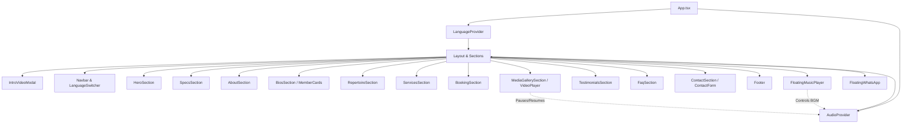

# Requirements

### Overview & Goals
The goal of this migration is to convert the existing single-file static HTML/CSS/JS website (`index.html`) for **Sax Machine** into a modern, component-driven, maintainable **React + TypeScript** web application.

### Scope
- **In Scope:**
  - Full functional and visual parity with the existing `index.html`.
  - Componentization and identification of reusable UI primitives and domain sections.
  - Type-safe internationalization (ES/EN) migration using React Context or structured dictionary.
  - Interactive feature parity:
    - Background music player with floating toggle, auto-unlock on interaction, and auto-pause when gallery video plays.
    - Intro animated video overlay with `sessionStorage` persistence and skip button.
    - Responsive navigation bar with scroll detection and mobile menu drawer.
    - Accordion FAQ list.
    - Contact form generating mailto URI with pre-filled fields.
    - PDF press kit download links and external social links.
  - Modern build setup using Vite and TypeScript.
- **Out of Scope:**
  - Backend server or database implementation (remains client-side static site with mailto / direct links).
  - Redesigning the existing branding, typography, or color palette.

### User Stories
- **As a prospective cruise/event booker**, I want to browse Sax Machine's services, repertoire, and duo biographies in my preferred language (Spanish or English) so that I can evaluate their offering and request availability.
- **As a site visitor**, I want to watch their promo videos and listen to background audio seamlessly without audio conflicts so that I get an engaging multimedia experience.
- **As a developer**, I want a structured, modular React component architecture with TypeScript types so that maintaining and updating site content or adding new features is straightforward.

### Functional Requirements
- **Language Switcher (i18n):** Support switching between Spanish (`es`) and English (`en`) seamlessly, updating all section headers, paragraphs, badges, placeholders, and dynamic email subjects.
- **Intro Splash Screen:** Display `intro.mp4` on first visit per session, with a skip button and auto-hide upon completion or skip. Prevent repeated displays in the same session via `sessionStorage`.
- **Background Music Player:** Floating toggle button at the bottom-right; ambient volume level (0.35); automatically pauses when the gallery showcase video starts playing, and resumes when paused/ended.
- **Contact Form:** Validate inputs and open user's default email client (`mailto:`) with properly formatted and URL-encoded subject and body based on the selected language.
- **Responsive Layout:** Full mobile responsiveness matching the existing breakpoints (desktop, tablet, mobile <= 560px/860px).

# Technical Design

### Current Implementation
The current project consists of:
- `index.html`: Contains ~660 lines including `<style>` tags with CSS variables (`:root`), HTML markup for 11 distinct sections, and a `<script>` block handling i18n dictionaries (`es`, `en`), DOM translation helpers, audio controllers, intersection observers, and form mailto generation.
- `images/`: Media assets including video clips (`intro.mp4`, `video_web.mp4`), audio (`musica.mp3`), and photography (`hero.jpg`, `duo.jpg`, `jonathan.jpeg`, `felipe.jpeg`, `show1-6.jpg`, `logo_blanco.png`).
- PDF documents: `SaxMachine_Brochure_ES.pdf` and `SaxMachine_Brochure_EN.pdf`.

---

### Component Hierarchy & Reusability Identification

#### 1. Core UI / Atoms & Molecules (Reusable across multiple sections)
- `Button` (`src/components/common/Button.tsx`): Supports variants (`gold`, `ghost`, `outline`, `link`) and sizes.
- `SectionHeader` (`src/components/common/SectionHeader.tsx`): Standardized eyebrow (uppercase gold tracker), section title (serif or sans), and optional lead/subtitle text.
- `Badge` / `Chip` (`src/components/common/Badge.tsx`): Reusable pill/chip styling used for repertoire styles, hero badges, bio tags, and trust indicators.
- `Card` (`src/components/common/Card.tsx`): Standard card container with dark/light themes and hover elevations used across Services, Formats, and Testimonials.
- `Accordion` / `FaqItem` (`src/components/common/Accordion.tsx`): Accessible expandable component for FAQ entries.

#### 2. Layout & Global Navigation
- `Navbar` (`src/components/layout/Navbar.tsx`): Fixed header with scroll transition (`header.scrolled`), brand logo, anchor nav links, language toggle, and mobile burger menu.
- `Footer` (`src/components/layout/Footer.tsx`): Social media links (Instagram, YouTube, WhatsApp), centered brand logo, and dynamic copyright year.
- `LanguageSwitcher` (`src/components/layout/LanguageSwitcher.tsx`): Pill toggle between `ES` and `EN`.

#### 3. Floating Interactive Widgets
- `FloatingMusicPlayer` (`src/components/widgets/FloatingMusicPlayer.tsx`): Floating button managing `<audio>` playback state, sound unlock on user interaction, and mute toggle.
- `FloatingWhatsApp` (`src/components/widgets/FloatingWhatsApp.tsx`): Fixed WhatsApp quick-contact button.
- `IntroVideoModal` (`src/components/widgets/IntroVideoModal.tsx`): Fullscreen video overlay with auto-dismiss and `sessionStorage` gating.

#### 4. Feature / Domain Sections
- `HeroSection`: Headline, value proposition, badges, CTA buttons, and background wave SVG.
- `SpecsSection`: Quick-facts agency grid displaying formation, category, home region, repertoire duration, and show languages.
- `AboutSection`: Duo backstory, experience counter stats (+10 years, 2 saxes, 100% custom), and featured photo.
- `BiosSection`: Contains reusable `MemberCard` components for Jonathan Gatica and Felipe Vidal (photo, role, biography, and tags).
- `RepertoireSection`: Section header and dynamic genre chips.
- `ServicesSection`: 3-column service cards (Onboard Sets, Private Events, Custom Ambiance).
- `BookingSection`: 2-column layout with `FormatList` (icons + description) and `StepsList` (numbered process).
- `MediaGallerySection`: Featured `VideoPlayer` component (`video_web.mp4`) that coordinates with background audio, photo grid with modal/lightbox or hover tiles, and external channel links.
- `TestimonialsSection`: `QuoteCard` grid with quotation styling, author attribution, and trust tags.
- `FaqSection`: Accordion-based FAQ list.
- `ContactSection`: Duo contact information, PDF press kit downloads, and controlled `ContactForm`.

---

### Key Decisions

1. **Build Tool & Framework**:
   - **Vite + React (TypeScript)**: Fast HMR, clean build output, lightweight static asset handling.
2. **Styling Strategy**:
   - **CSS Modules or Scoped CSS files referencing global `:root` design tokens**: Preserves the exact custom gold/navy luxury aesthetic, typography, and responsive media queries from the original design while preventing selector collisions.
3. **Internationalization (i18n)**:
   - **`LanguageContext` with typed dictionaries**: Since the site is a single landing page with ~50 translation keys across Spanish and English, a lightweight, type-safe React Context (`LanguageProvider`) provides clean state management without heavyweight external library overhead.
4. **Audio & Media Coordination**:
   - **`AudioContext`**: Centralizes background music playback state and provides an imperative `pause()`/`resume()` hook that `VideoPlayer` invokes when users play promotional videos.

---

### Data Models / Contracts

```typescript
// src/types/content.ts
export type Language = 'es' | 'en';

export interface SpecItem {
  id: string;
  labelKey: string;
  valueKey: string;
}

export interface MemberBio {
  id: string;
  name: string;
  roleKey: string;
  bioKey: string;
  image: string;
  tags: string[];
}

export interface ServiceItem {
  id: string;
  icon: string;
  titleKey: string;
  descKey: string;
}

export interface BookingFormat {
  id: string;
  icon: string;
  titleKey: string;
  descKey: string;
}

export interface BookingStep {
  step: number;
  titleKey: string;
  descKey: string;
}

export interface Testimonial {
  id: string;
  quoteKey: string;
  authorKey: string;
}

export interface FaqItemData {
  id: string;
  questionKey: string;
  answerKey: string;
}

export interface ContactFormData {
  name: string;
  email: string;
  serviceType: string;
  message: string;
}
```

---

### Architecture Diagram



---

### Proposed File Structure

```
saxmachinewebsite/
├── public/
│   ├── images/
│   │   ├── duo.jpg
│   │   ├── felipe.jpeg
│   │   ├── hero.jpg
│   │   ├── intro.mp4
│   │   ├── jonathan.jpeg
│   │   ├── logo_blanco.png
│   │   ├── musica.mp3
│   │   ├── show1.jpg .. show6.jpg
│   │   └── video_web.mp4
│   ├── SaxMachine_Brochure_EN.pdf
│   └── SaxMachine_Brochure_ES.pdf
├── src/
│   ├── assets/
│   ├── components/
│   │   ├── common/
│   │   │   ├── Accordion.tsx
│   │   │   ├── Badge.tsx
│   │   │   ├── Button.tsx
│   │   │   ├── Card.tsx
│   │   │   └── SectionHeader.tsx
│   │   ├── layout/
│   │   │   ├── Footer.tsx
│   │   │   ├── LanguageSwitcher.tsx
│   │   │   └── Navbar.tsx
│   │   ├── sections/
│   │   │   ├── AboutSection.tsx
│   │   │   ├── BiosSection.tsx
│   │   │   ├── BookingSection.tsx
│   │   │   ├── ContactSection.tsx
│   │   │   ├── FaqSection.tsx
│   │   │   ├── HeroSection.tsx
│   │   │   ├── MediaGallerySection.tsx
│   │   │   ├── RepertoireSection.tsx
│   │   │   ├── ServicesSection.tsx
│   │   │   ├── SpecsSection.tsx
│   │   │   └── TestimonialsSection.tsx
│   │   └── widgets/
│   │       ├── FloatingMusicPlayer.tsx
│   │       ├── FloatingWhatsApp.tsx
│   │       └── IntroVideoModal.tsx
│   ├── context/
│   │   ├── AudioContext.tsx
│   │   └── LanguageContext.tsx
│   ├── hooks/
│   │   ├── useIntersectionObserver.ts
│   │   └── useScrolledHeader.ts
│   ├── i18n/
│   │   └── translations.ts
│   ├── styles/
│   │   ├── globals.css
│   │   └── variables.css
│   ├── types/
│   │   ├── content.ts
│   │   └── translations.ts
│   ├── App.tsx
│   ├── main.tsx
│   └── vite-env.d.ts
├── index.html
├── package.json
├── tsconfig.json
└── vite.config.ts
```

---

### Risks & Mitigations
- **Browser Autoplay Policies**: Modern browsers block audio autoplay without user gesture. *Mitigation:* Audio begins muted or waits for the initial user interaction (click/touch/scroll) as already implemented in the original vanilla script, with explicit visual toggle state.
- **Video & Audio Concurrency**: Playing the promo video while background music is running creates audio overlap. *Mitigation:* `AudioContext` provides lifecycle hooks so `VideoPlayer` triggers automatic BGM pausing when playing and resumes upon video pause/finish.
- **Form Mailto Encoding**: Special characters in Spanish (tildes, ñ) can corrupt email clients. *Mitigation:* Use `encodeURIComponent` for both subject and body formatting in the React form submit handler.

# Testing

### Validation Approach
Verification will be performed through structured inspection and functional checks:

1. **Compilation & Build Validation**:
   - Run TypeScript type checking (`tsc --noEmit`) to verify zero type errors.
   - Run Vite production build (`npm run build`) to ensure assets and chunks bundle correctly.

2. **Key Functional Scenarios**:
   - **Language Switching**: Toggle between `ES` and `EN` and verify that all section titles, paragraphs, badges, button labels, and form placeholders update dynamically.
   - **Intro Video Splash**: Verify video plays on fresh visit; clicking "Saltar / Skip" or reaching video end smoothly fades out and removes the modal; verify subsequent page reloads in the same session skip the intro via `sessionStorage`.
   - **Background Audio Controls**: Verify floating music button toggles audio play/pause state; verify background music automatically pauses when the gallery video is played and resumes when the video stops.
   - **Navigation & Mobile Drawer**: Verify navbar adds `scrolled` background class on scroll; verify hamburger menu opens and closes the mobile drawer on viewports < 860px; verify anchor links scroll smoothly to target sections.
   - **Contact Form Mailto**: Fill out the contact form and trigger submit; verify formatted `mailto:` URL is generated with correct subject line and body text matching the active language.
   - **Asset & PDF Downloads**: Verify Press Kit links open the corresponding Spanish and English PDF brochures.

3. **Visual & Layout Inspection**:
   - Inspect desktop (1200px+), tablet (768px-1024px), and mobile (375px-480px) viewports to verify grid layouts (About, Bios, Services, Booking, Gallery, Testimonials) adapt properly without overflow.

# Delivery Steps

### ✓ Step 1: Project Setup and Foundation
Initialize the React project structure and configure tooling.

- Initialize a Vite + React + TypeScript project configuration in `package.json`, `tsconfig.json`, and `vite.config.ts`.
- Move and organize assets (images, audio, video, PDF brochures) to the `public/` or `src/assets/` directories.
- Extract global CSS variables (colors, fonts, layout tokens) and reset rules into `src/styles/globals.css`.
- Ensure base HTML template (`index.html`) has correct metadata, responsive viewport, and root mounting point.

### ✓ Step 2: Core Contexts, Hooks, and Shared UI Primitives
Build the shared data layer, state contexts, and atomic UI components.

- Create `src/i18n/translations.ts` containing the complete Spanish and English dictionaries extracted from `index.html`.
- Implement `LanguageContext` and `useLanguage` hook for toggling and accessing active translations.
- Implement `AudioContext` and `useBackgroundAudio` hook to manage background music state and coordinate with media playback.
- Implement reusable UI primitives: `Button`, `SectionHeader`, `Badge`/`Chip`, `Card`, and `Accordion`/`FaqItem`.

### ✓ Step 3: Navigation, Layout, and Floating Widgets
Build site chrome, navigation, persistent footer, and floating interactive controls.

- Implement `Navbar` with scroll-detection styling, responsive mobile hamburger drawer, and `LanguageSwitcher`.
- Implement `Footer` with social links, branding, and dynamic copyright year.
- Implement `IntroVideo` overlay component with session storage detection and skip button.
- Implement `FloatingMusicPlayer` (with mute toggle and wave indicator) and `FloatingWhatsApp` button.

### ✓ Step 4: Content Sections Implementation
Create modular React components for each content section of the landing page.

- Build `HeroSection` (eyebrow, title, lead, badges, CTAs, SVG wave divider).
- Build `SpecsSection` (quick facts agency grid) and `AboutSection` (narrative, stats counters, photo card).
- Build `BiosSection` with reusable `MemberCard` components for Jonathan Gatica and Felipe Vidal.
- Build `RepertoireSection` (genre chips) and `ServicesSection` (`ServiceCard` grid).
- Build `BookingSection` (format cards and 3-step timeline) and `TestimonialsSection` (`QuoteCard` grid and trust badges).
- Build `MediaGallerySection` (featured HTML5 video player and photo grid) and `FaqSection` (collapsible FAQ list).
- Build `ContactSection` (contact info, PDF press kit download links, and controlled `ContactForm` generating mailto links).

### ✓ Step 5: Interactivity Wiring, Polish, and End-to-End Validation
Assemble all sections in `App.tsx`, integrate scroll animations, coordinate audio-video states, and verify functionality.

- Compose all components in `src/App.tsx`.
- Connect background audio auto-pause/resume events when the gallery video plays or pauses.
- Add Intersection Observer or lightweight animation hook for scroll-reveal effects across sections.
- Verify end-to-end functionality: ES/EN language toggling, contact form mailto generation, mobile menu responsiveness, and asset loading.
- Run typecheck and production build (`npm run build`) to validate zero TypeScript or bundling errors.